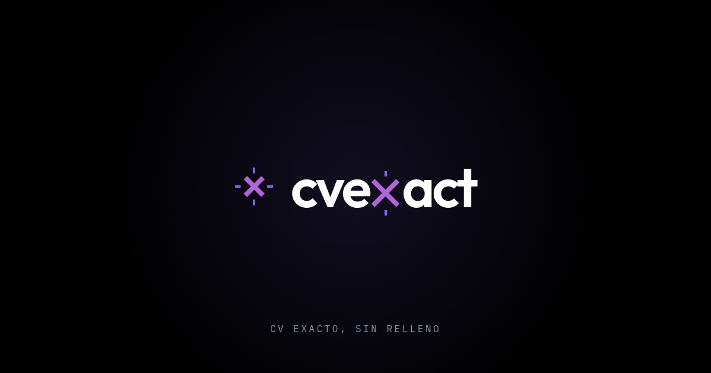

# CVExact

CVExact genera un CV adaptado a cada oferta laboral, responde las preguntas del
formulario de postulación, escribe el email de presentación, prepara la entrevista y
redacta el guion del video de presentación que algunas búsquedas piden grabar.



## Qué hace

- **CV en una hoja, con formato controlado.** El modelo no emite HTML: emite JSON
  validado con Zod y un renderer determinista produce el layout de la plantilla.
  El PDF se imprime en el servidor con Chromium para que no dependa del diálogo del
  navegador.
- **Un CV, dos formatos.** El mismo documento alimenta el renderer HTML/PDF y el
  renderer `.docx` para los portales que rechazan PDF.
- **Perfil que se puede importar y revisar.** Un lector determinista extrae el
  contenido de un CV, un PDF de LinkedIn o el ZIP de datos de LinkedIn; la IA es
  opcional y nunca un requisito para arrancar.
- **Postulación completa.** Análisis del aviso, respuestas del formulario, email,
  preparación de entrevista y seguimiento de postulaciones.
- **Privacidad por defecto.** El perfil vive en el navegador. La cuenta y la
  sincronización son opcionales; el documento del CV no se sube al tracker.

## Cómo funciona

```
Oferta laboral ──► JobAnalysis ──┐                        ┌─► renderer HTML ──► Chromium ──► PDF
                                 ├──► CVDocument JSON ──► ┤
Perfil ──► ProfileInference ─────┤──► respuestas del      └─► renderer docx ──────────────► .docx
                                 │    formulario
                                 ├──► email de presentación
                                 └──► InterviewPrep JSON ──► renderer ──► Chromium ──► PDF
```

El detalle de la arquitectura, las decisiones de formato, el ajuste a una hoja y el
tracker está en [`docs/arquitectura.md`](docs/arquitectura.md).

## Stack

Next.js 16 (App Router), React 19, TypeScript, Tailwind CSS 4, PostgreSQL con
Drizzle ORM, Better Auth, IndexedDB/Dexie en el navegador y Playwright/Chromium para
la impresión de PDFs.

## Requisitos

- Node.js 20.9 o superior.
- pnpm 11.21.0 (el que declara `packageManager`).
- Docker 24+ y Docker Compose, sólo si vas a autoalojar.
- PostgreSQL 18 para cuentas, sincronización y tracker (opcional en desarrollo).

## Instalación

```bash
pnpm install
pnpm dev
```

Abre <http://localhost:3000>. Sin configurar nada se puede recorrer la app y ver la
plantilla en `/cv/demo/print`. Para generar un CV de verdad hace falta una API key:
se elige el proveedor y se pega en **Ajustes**; queda sólo en el navegador. También
se puede usar la key del servicio con `SERVICE_API_KEY` en `.env`.

## Configuración

```bash
cp .env.example .env
```

Todas las variables son opcionales y cada bloque enciende una función. Las mínimas
para cuentas son `DATABASE_URL`, `BETTER_AUTH_SECRET` y `BETTER_AUTH_URL`. Para
producción también hay que definir `NEXT_PUBLIC_SITE_URL`.

- `.env.example` documenta cada bloque.
- `.env` no se versiona: contiene secretos reales.
- `NEXT_PUBLIC_SOURCE_URL` es la URL del código de la versión desplegada; se usa
  para el enlace «Código fuente» que pide la AGPL. **Se inlinea en el build**:
  definila antes de `pnpm build`/`docker build` (por ejemplo, con
  `--build-arg`), no sólo en el entorno del contenedor. Si queda vacía, el enlace
  no se muestra. En producción debe apuntar al tag o commit que efectivamente corre.
- `pnpm verify:publication-source` (después del build, con la misma variable)
  comprueba que la URL no sea ficticia y que el HTML generado muestre el enlace.
- `pnpm audit:publication` revisa qué archivos se publicarían, que las reglas
  críticas de `.gitignore` sigan presentes y que no haya secretos evidentes.

## Scripts

| Comando | Qué hace |
|---|---|
| `pnpm dev` | Servidor de desarrollo |
| `pnpm build` | Build de producción (`next build` + verificación legal) |
| `pnpm start` | Servidor de producción |
| `pnpm lint` | ESLint |
| `pnpm typecheck` | `next typegen` + TypeScript |
| `pnpm test` | Vitest |
| `pnpm audit:publication` | Auditoría de archivos y secretos antes de publicar |
| `pnpm verify:publication-source` | Verifica el enlace AGPL en el build ya compilado |
| `pnpm db:generate` | Genera migraciones de Drizzle |
| `pnpm db:migrate` | Aplica migraciones (`node --env-file=.env`) |

## Pruebas

```bash
pnpm lint
pnpm typecheck
pnpm test
pnpm build
```

Los tests no tocan la red ni una base real: mockean el cliente. Los fixtures usan
datos ficticios y `tests/fixtures-no-pii.test.ts` revisa que los correos de
demostración no puedan corresponder a personas reales.

## Despliegue

La forma corta de levantar una instancia propia es Docker Compose:

```bash
cp .env.example .env
# completar POSTGRES_PASSWORD, BETTER_AUTH_SECRET, BETTER_AUTH_URL,
# NEXT_PUBLIC_SITE_URL y NEXT_PUBLIC_SOURCE_URL
docker compose -f deploy/docker-compose.yml --env-file .env up -d --build
```

La guía completa, con qué es obligatorio, qué queda apagado y cómo se protege la
instancia, está en [`docs/SELF-HOSTING.md`](docs/SELF-HOSTING.md). La infraestructura
de `cvexact.com` no forma parte de este repositorio.

## Extensión y worker

- [`extension/`](extension/README.md): extensión de navegador (WXT) que guarda el
  aviso que estás mirando con un click.
- [`workers/tracker-email/`](workers/tracker-email/README.md): Cloudflare Email
  Worker para la detección de estados por correo.
- `extension/store-assets/screenshot-1-conectar-1280x800.png`: captura de la
  extensión con datos ficticios.

## Estructura

```
app/                  rutas de Next.js (landing, perfil, postular, tracker, API)
components/           UI, renderers y escenas de la landing
lib/                  dominio: esquemas, IA, parseo, perfil, export, tracker
public/               fuentes, iconos, plantilla de CV y assets estáticos
deploy/               Docker Compose para autoalojar
docs/                 arquitectura, autoalojamiento, legal y guías públicas
tests/                Vitest y fixtures sintéticos
workers/              Cloudflare Email Worker
extension/            extensión de navegador (deploy aparte)
```

## Documentación

- [`docs/arquitectura.md`](docs/arquitectura.md) — arquitectura y decisiones técnicas.
- [`docs/SELF-HOSTING.md`](docs/SELF-HOSTING.md) — autoalojamiento con Docker.
- [`docs/CONTRIBUTING.md`](docs/CONTRIBUTING.md) — entorno, DCO y estilo de commits.
- [`docs/plantilla-cv.md`](docs/plantilla-cv.md) — especificación de la plantilla.
- [`docs/legal/versiones.md`](docs/legal/versiones.md) — versiones de los textos legales.
- [`SECURITY.md`](SECURITY.md) — cómo reportar una vulnerabilidad.
- [`THIRD_PARTY.md`](THIRD_PARTY.md) y [`THIRD_PARTY_LICENSES/`](THIRD_PARTY_LICENSES/) — licencias de terceros.
- [`ASSETS.md`](ASSETS.md) y [`TRADEMARKS.md`](TRADEMARKS.md) — activos y marcas.
- [`docs/PUBLISHING.md`](docs/PUBLISHING.md) — checklist para publicar el repositorio.

## Licencia y uso comercial

CVExact se distribuye bajo **GNU Affero General Public License, versión 3 o
posterior** (AGPL-3.0-or-later). El texto completo está en [`LICENSE`](LICENSE).
Las contribuciones se aceptan con el Developer Certificate of Origin (`git commit -s`),
sin CLA; ver [`docs/CONTRIBUTING.md`](docs/CONTRIBUTING.md).

Cobrar por el servicio, por una instancia alojada, por soporte o por funciones
adicionales es compatible con AGPL. Lo que la licencia no permite es recibir las
mejoras de la comunidad y mantener cerradas las modificaciones del código cubierto
cuando se ofrece el servicio por red: en ese caso hay que ofrecer el código fuente
correspondiente a quienes lo usan. La marca y la identidad visual se reservan aparte
(ver [`TRADEMARKS.md`](TRADEMARKS.md)); un fork puede reutilizar el código con otro
nombre e identidad. Si el modelo de negocio necesita mantener componentes cerrados,
hay que decidir la estrategia de licencia **antes** de aceptar contribuciones y, si
corresponde, separar esos componentes o conseguir derechos adicionales. Esto no es
asesoría legal.

## Contribuir

Leé [`docs/CONTRIBUTING.md`](docs/CONTRIBUTING.md). En resumen: un commit coherente
por cambio, `Signed-off-by` en cada commit, tests para los cambios de comportamiento,
documentación en español e identificadores en inglés, y ningún dato personal real
en fixtures, capturas o issues.

## Seguridad

No abras un issue público para una vulnerabilidad: seguí [`SECURITY.md`](SECURITY.md).
