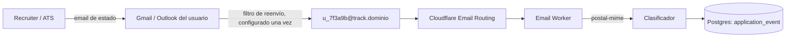

# Fase 3 — Detección de estados por email

Este documento especifica la Fase 3 del tracker de postulaciones y documenta
las decisiones que se tomaron al implementarla. El código está en el repo:
clasificador y orquestación en `lib/tracker/email-classifier.ts`,
`email-match.ts` y `email-ingest.ts`; las rutas en
`app/api/tracker/email-inbox/route.ts` (activar/consultar/revocar, con
consentimiento) y `app/api/tracker/email/ingest/route.ts` (lo que llama el
Worker); la UI en `app/(app)/postulaciones/EmailInboxCard.tsx`; el Worker de
Cloudflare en `workers/tracker-email/`.

**Lo único que no se puede hacer desde este repo es el deploy en sí** — crear
la cuenta/dominio en Cloudflare, activar Email Routing, publicar el Worker
con `wrangler` y cargarle sus secretos. Esos pasos están en
`workers/tracker-email/README.md`. Sin ese deploy, `TRACKER_EMAIL_DOMAIN` no
está configurado, `trackerEmailConfigured` da `false`, y
`EmailInboxCard` no se muestra — la instalación funciona exactamente igual
que antes de esta fase.

## Decisiones que no estaban en el diseño original, tomadas al implementar

- **Confianza baja → nota en la línea de tiempo, no una tabla de
  "propuestas" nueva.** El schema de esta fase es sólo `email_inbox` — sin
  una tabla de correos sin clasificar. Un correo con confianza por debajo
  del umbral (`CLASSIFIER_CONFIDENCE_THRESHOLD = 0.6`) no cambia
  `application.status`: inserta un evento `event_type = 'nota'`,
  `detected_from = 'email'`, con `confidence`/`raw_sender`/`raw_subject`
  completos y un `body` que describe qué se sospechó. El usuario lo lee en
  el detalle y cambia el estado a mano si corresponde — cumple "proponer el
  cambio y que el usuario confirme" sin inventar un mecanismo de
  aceptar/rechazar una propuesta.
- **Ambigüedad (cero o más de una postulación abierta cuyo nombre de
  empresa aparece en el correo) se descarta, sin persistir nada.** Mismo
  motivo: no hay tabla de "correos sin emparejar". `lib/tracker/email-match.ts`
  documenta el límite. Es honesto, no una simplificación de paso — si esto
  se vuelve un problema real en uso, la solución es esa tabla nueva, no un
  ajuste a la heurística.
- **El trigger de las migraciones 0017/0020** ahora también acepta
  `app.event_confidence`, `app.event_raw_sender`, `app.event_raw_subject`
  como GUCs opcionales — así un cambio de estado de alta confianza sigue
  pasando por el mismo escritor único de eventos que todo el resto del
  tracker (moveCard, ghosting), en vez de que la Fase 3 tuviera que hacer un
  `UPDATE` seguido de un `UPDATE` sobre la fila que el trigger generó.
- **El Worker es deliberadamente tonto.** Parsea el MIME con `postal-mime` y
  reenvía remitente/asunto/texto a `POST /api/tracker/email/ingest` — toda
  la clasificación, el matching y la decisión de aplicar/proponer viven en
  TypeScript testeado en este repo, no en el Worker. `x-origin-auth`
  (`ORIGIN_AUTH_SECRET`) es lo único que exige la ruta, el mismo secreto que
  usa `scripts/tracker-cron.mjs`.
  **Corrección (auditoría legal, 2026-09-18):** esto NO hace la ruta interna.
  La Transform Rule de Cloudflare agrega ese header a todo el tráfico público,
  así que `POST /api/tracker/email/ingest` es alcanzable desde internet. Lo
  que la protege es el alias (`u_` + 12 hex, 48 bits), que no es adivinable, y
  que sin alias válido y consentimiento no se escribe nada. A diferencia de
  `/api/tracker/cron` y `/api/jobs/alerts/send` no puede usar
  `lib/api/internal-only.ts`, porque el Worker entra por la URL pública. Cerrar
  el resto pide un secreto propio en el Secret y en el Worker; ver
  `INCIDENTES.md`.
- **`email_inbox.verified_at`** se marca solo la primera vez que un correo
  real llega al alias, no con un flujo de verificación aparte — es la prueba
  de que el filtro de reenvío que la persona configuró funciona.

## Por qué esta arquitectura, y no otra

La restricción dura de costo cero descarta la opción obvia: la **Gmail API**.
Sus scopes de lectura (`gmail.readonly`, `gmail.modify`, `gmail.metadata`) son
*restricted scopes* — cualquiera de ellos en producción exige una evaluación
de seguridad **CASA** anual, paga, hecha por un laboratorio externo, que
cuesta cientos o miles de dólares por año y tarda 6 a 12 semanas. No se
evaluó como alternativa real por esto, no porque fuera técnicamente peor.

La alternativa elegida no lee la casilla del usuario en absoluto: el usuario
**reenvía** los correos de ATS a una dirección nuestra, vía un filtro que
configura una vez en su propio proveedor. Eso mueve todo el "leer email de
alguien" fuera de nuestro perímetro legal y técnico — nunca pedimos ni
guardamos una contraseña ni un token de OAuth de Gmail/Outlook.

## Arquitectura

1. Cada usuario recibe una dirección única en un subdominio nuestro:
   `u_7f3a9b@track.<dominio>` — el alias vive en `email_inbox.alias`, generado
   una sola vez y nunca derivado del correo real de la cuenta, para poder
   rotarlo sin tocarla.
2. El usuario configura en Gmail/Outlook un filtro que reenvía automáticamente
   los correos de dominios de ATS conocidos a esa dirección. Instrucciones
   guiadas por proveedor, en español, en la propia pantalla de activación.
3. **Cloudflare Email Routing** (gratis; inbound sin límite de volumen;
   requiere que el DNS del dominio esté en Cloudflare; máximo 200 reglas;
   mensajes hasta 25 MiB; desde el 30/6/2025 exige SPF o DKIM válido en el
   dominio de origen — verificar este límite antes de depender de él, cambia)
   enruta el mensaje a un **Email Worker**.
4. El Worker parsea el MIME con **postal-mime**, clasifica, y escribe
   directamente en Postgres (el mismo Postgres de la app — el Worker necesita
   su propia conexión, ver "Notas operativas" abajo). Free tier de Cloudflare
   Workers: 100.000 requests/día — verificar vigente antes de depender.

Cloudflare Email Routing es **sólo inbound**. El envío saliente (recordatorios,
avisos de ghosting) sigue por Resend/Brevo vía `lib/email/mailer.ts`, sin
cambios.

## Clasificador, sin LLM

Prohibido por la restricción de costo: ningún proveedor de LLM de pago para
esto. La clasificación es dos señales, en orden de confianza:

1. **Dominio del remitente** — alta confianza. Tabla de ATS conocidos:

   | ATS | Remitente |
   |---|---|
   | Greenhouse | `no-reply@greenhouse.io`, `no-reply@us.greenhouse-mail.io` |
   | Lever | `no-reply@hire.lever.co` |
   | Ashby | `no-reply@ashbyhq.com` |
   | Workable | `noreply@candidates.workablemail.com` |
   | SmartRecruiters | `notifications@smartrecruiters.com` |
   | Workday | `<tenant>@myworkday.com` |
   | Recruitee | `<nombre>.<cuenta>@recruitee.com` |
   | Teamtailor | `no-reply@<empresa>.teamtailor-mail.com` |
   | BambooHR | dominio `@bamboohr.com` |
   | Gupy (BR) | dominio `gupy.com.br` |
   | Computrabajo | dominio `computrabajo.com` |
   | Bumeran / ZonaJobs | `bumeran.com.ar` / `zonajobs.com.ar` |
   | Get on Board | `info@getonbrd.com` |

2. **Regex multiidioma (es/en/pt)** sobre asunto y cuerpo — baja confianza,
   segunda señal:

   | Categoría | Palabras clave |
   |---|---|
   | Rechazo | unfortunately, not moving forward, we've decided, no continuará, no fue seleccionado, lamentamos, en esta oportunidad, infelizmente, não seguiremos |
   | Entrevista | interview, entrevista, schedule a call, agendar, disponibilidad, coordinar una llamada, agendamento |
   | Evaluación | assessment, technical test, challenge, prueba técnica, evaluación, desafío, teste |
   | Oferta | offer, oferta, propuesta laboral, we'd like to offer, proposta |
   | Confirmación | application received, hemos recibido, gracias por postularte, recebemos sua candidatura |

**Advertencia de diseño, explícita a propósito:** los asuntos exactos de la
mayoría de estos ATS no están documentados públicamente, y muchos son
configurables por el reclutador de cada empresa. La tabla de arriba son
hipótesis a validar contra datos reales, no hechos verificados. El
clasificador está diseñado para eso:

- Guarda siempre `raw_sender` y `raw_subject` en `application_event`, nunca
  descartados — es la auditoría con la que se corrigen las reglas.
- Guarda `confidence` (0..1). Por debajo de un umbral (a definir con datos
  reales; arrancar en 0.6), **no cambia el estado solo**: crea un evento
  propuesto y notifica al usuario para que confirme o descarte, en vez de
  mover el kanban por su cuenta.
- Override manual siempre disponible — el "cambiar estado" explícito del
  tracker no deja de funcionar porque exista un clasificador.

## Filtro anti-ruido

Computrabajo y portales similares mandan digests diarios de ofertas nuevas.
El clasificador tiene que distinguir un digest ("20 avisos que podrían
interesarte") de un correo de estado real sobre una postulación concreta —
si no, cada digest crearía una postulación fantasma. Señales para descartar
un digest: el asunto no menciona un puesto ni empresa específicos que ya
estén en `application`, y el cuerpo lista más de un aviso. Esto también es
una hipótesis a validar con correos reales antes de escribir la regla final.

## Privacidad — obligatorio, no opcional

- **Consentimiento explícito, informado y revocable**, registrado en
  `email_inbox.consent_at`, antes de procesar cualquier correo. Sin esa
  fecha, nada de lo reenviado a `alias` se lee.
- **Minimización de datos**: se procesa preferentemente remitente, asunto y
  fecha. **No se almacenan cuerpos completos de email.** Si clasificar exige
  mirar el cuerpo, se procesa en memoria dentro del Worker y sólo se guarda
  el resultado (evento + `confidence` + `raw_subject`), nunca el texto
  completo del cuerpo.
- **Endpoint de revocación**: borra `email_inbox` (alias incluido) y todo lo
  derivado. A partir de ahí, un correo reenviado a la vieja dirección
  simplemente no llega a nadie (Cloudflare ya no tiene la regla).
- Todo esto documentado en la política de privacidad en español, con
  referencia a la Ley 25.326 argentina — clausula nueva, análoga a la 14
  (alertas de empleo), en el momento en que esta fase se implemente.

## Notas operativas para cuando se implemente

- El Worker corre en el runtime de Cloudflare, no en Next.js — necesita su
  propia conexión a Postgres (o pegarle a una route interna de la app, igual
  que el cron de ghosting le pega a `/api/tracker/cron` con
  `x-origin-auth`). La segunda opción reusa el perímetro que ya existe en
  `proxy.ts` y es la que se prefiere salvo que la latencia lo impida.
- Verificar antes de depender: límites vigentes de Cloudflare Email Routing y
  Workers (cambian), y que el dominio de envío de cada ATS listado arriba
  siga existiendo — un remitente puede migrar de dominio sin aviso.
- No hay crawling ni scraping en ningún punto de este diseño: todo lo que
  llega, llega porque el usuario configuró el reenvío él mismo.
